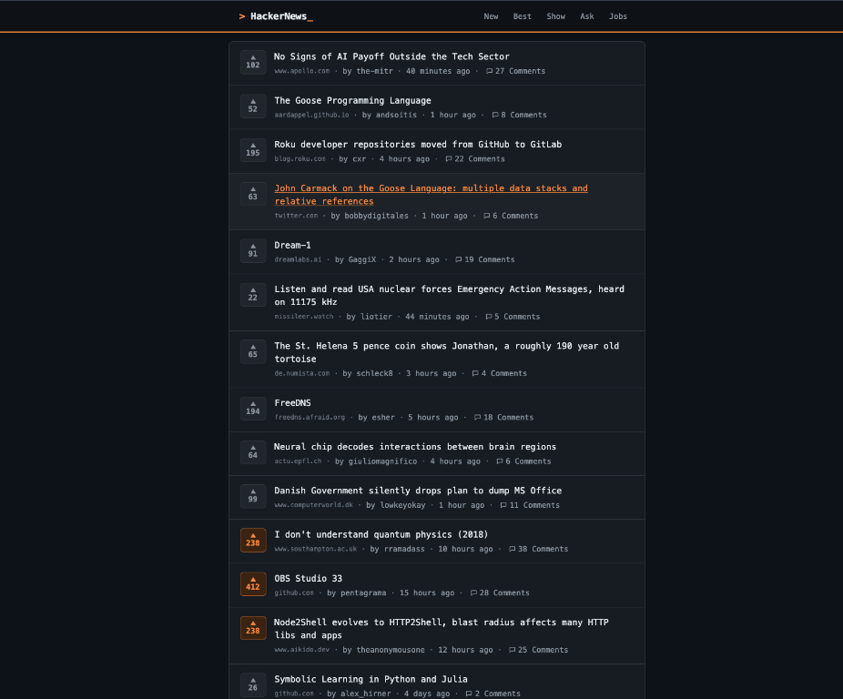

# Hacker News

## Built with

<p align="center">
    
</p>

Hacker News clone built with [Vue 3](https://vuejs.org), [Pinia](https://pinia.vuejs.org/), [Pinia Colada](https://pinia-colada.esm.dev/), [Tailwind](https://tailwindcss.com/) & [VueUse](https://vueuse.org/)

<p align="center">
  <a href="https://hnews-nurriyad.netlify.app" target="_blank">
    
    <br>
    Live Demo
  </a>
</p>

## Demo

https://hnews-nurriyad.netlify.app/

> Hosted on [Netlify](https://netlify.com/): `npm run build`

## Features

- Client Side Rendering
- Vite-based hot module replacement (HMR) dev environment
- Deploys anywhere with zero config Netlify
- SVG skeleton loaders
- Lazy-loaded comment threads

## Build Setup

**Requires Node.js 24** (see `.nvmrc`; run `nvm use`)

```bash
# install dependencies
npm ci

# serve in dev mode, with hot reload at localhost:5173
npm run dev

# lint, format and type-check
npm run check

# run the tests
npm test

# build for production
npm run build

# serve in production mode (localhost:4173)
npm run preview

```

### Docker

```bash
docker build -t vue-hacker-news .
docker run --rm -p 4173:4173 vue-hacker-news
```

## Architecture

A client-side app with no backend. It reads the public [Hacker News API](https://github.com/HackerNews/API) directly.

- `src/queries/hackerNews.ts`: typed Hacker News queries, cached and deduplicated by Pinia Colada.
- `src/views/`: route-level pages. `TheNews` lists and paginates stories (20 per page), `NewsDetails` shows a story with its comments, and `UserPage` shows a user profile.
- `src/components/`: item cards that read cached story, comment, and user data, plus loaders and icons.

| Route                                                       | View          |
| ----------------------------------------------------------- | ------------- |
| `/`, `/:type` (`top`, `new`, `best`, `show`, `ask`, `jobs`) | `TheNews`     |
| `/news/:id`, `/show/:id`, `/ask/:id`                        | `NewsDetails` |
| `/user/:userid`                                             | `UserPage`    |

## Working with AI agents

Project guidance for AI coding agents lives in [AGENTS.md](./AGENTS.md), with a short pointer in [.github/copilot-instructions.md](./.github/copilot-instructions.md).
